
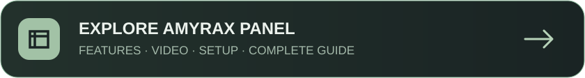

<picture>
  <source media="(prefers-reduced-motion: reduce)" srcset="docs/media/hero.png">
  
</picture>

<h3>اتصال ساده؛ مدیریت دقیق.</h3>

یک پنل فارسی برای ساخت کاربر، مدیریت حجم و اعتبار و تحویل اشتراک سازگار با اپ‌های مختلف.

  
  
  
  
  

<a href="https://amyraxvpn-main.github.io/Amyrax-Panel/"><strong>معرفی کامل، آموزش نصب، ویدئو و راهنما ←</strong></a>

پیشنهاد اصلی: <a href="https://botkeep.cloud/"><strong>Botkeep Cloud</strong></a>؛ معرفی همهٔ گزینه‌ها در <a href="https://amyraxvpn-main.github.io/Amyrax-Panel/#hosting">بخش سرورها</a>. برای اجرای پنل، سرویس <bdi>Node.js</bdi> را انتخاب کنید.

روی <strong>Railway</strong> هم با Fork و اتصال GitHub اجرا کنید؛ <a href="RAILWAY.md"><strong>مراحل نصب و حفظ اطلاعات ←</strong></a>

---

  
  
<strong>Amyrax Panel</strong> · <a href="https://t.me/AmyraxVPN">@AmyraxVPN</a>

