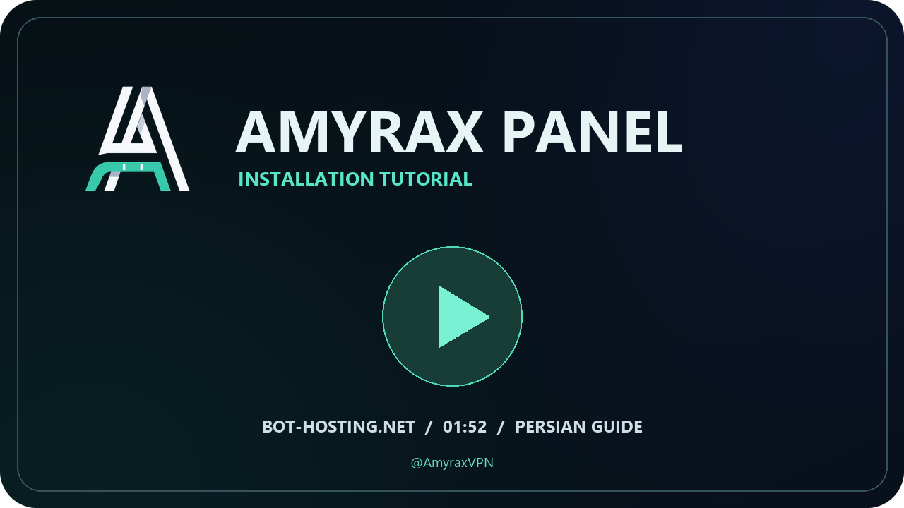
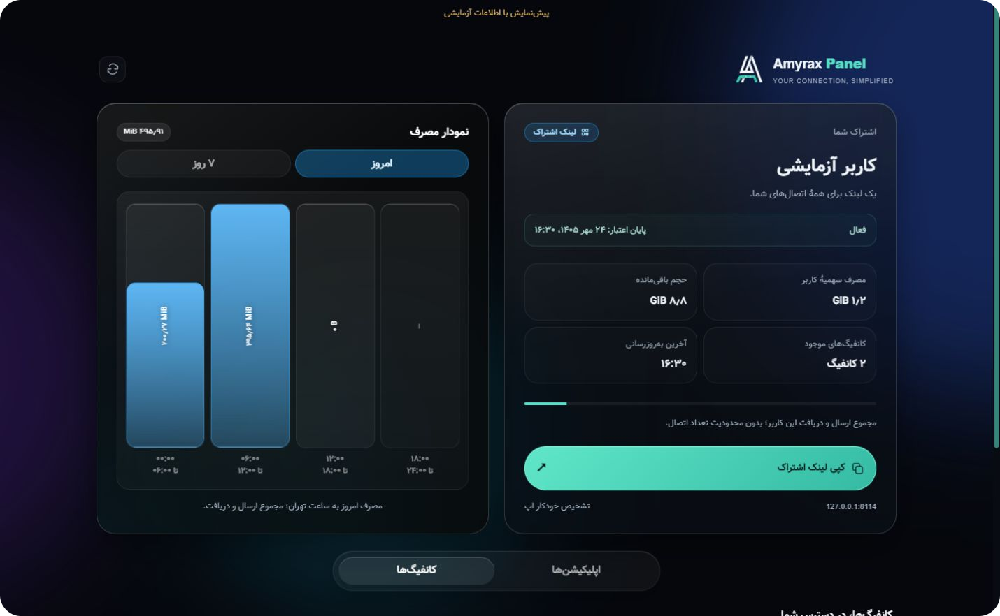

<div align="center">

<picture>
  <source media="(prefers-reduced-motion: reduce)" srcset="docs/media/hero.png">
  
</picture>

<h3>اتصال ساده؛ مدیریت دقیق.</h3>

<p>یک پنل فارسی برای ساخت کاربر، مدیریت حجم و اعتبار و تحویل اشتراک سازگار با اپ‌های مختلف.</p>

<p>
  
  
  <a href="https://t.me/AmyraxVPN"></a>
  <a href="https://bot-hosting.net/"></a>
</p>

<p>
  <a href="#tutorial">آموزش ویدئویی</a> ·
  <a href="#installation">نصب و راه‌اندازی</a> ·
  <a href="#users">ساخت کاربر</a> ·
  <a href="#clients">اپ‌های پیشنهادی</a> ·
  <a href="#faq">پرسش‌های رایج</a>
</p>

</div>

<div dir="rtl">

<h2 align="center">Amyrax Panel چه امکاناتی دارد؟</h2>

<table align="center" dir="rtl">
  <thead>
    <tr><th align="right">بخش</th><th align="right">کاربرد</th></tr>
  </thead>
  <tbody>
    <tr><td align="right">مدیریت کاربران</td><td align="right">ساخت، ویرایش، غیرفعال‌سازی، تمدید، حذف و تغییر لینک اشتراک</td></tr>
    <tr><td align="right">حجم و اعتبار</td><td align="right">سقف مصرف، مدت اعتبار، شروع از اولین اتصال و بازنشانی دوره‌ای حجم</td></tr>
    <tr><td align="right">اشتراک هوشمند</td><td align="right">یک لینک برای هر کاربر؛ تشخیص کلاینت و ارائهٔ قالب سازگار</td></tr>
    <tr><td align="right">صفحهٔ اشتراک</td><td align="right">نمایش وضعیت، حجم، انقضا، نمودار مصرف، کپی کانفیگ و QR</td></tr>
    <tr><td align="right">اتصال‌های متنوع</td><td align="right">VLESS، VMess، Trojan و Shadowsocks با روش‌های انتقال مختلف</td></tr>
    <tr><td align="right">انتخاب خودکار</td><td align="right">انتخاب بر اساس تأخیر در پروفایل‌های FlClash و sing-box</td></tr>
    <tr><td align="right">آمار و منابع</td><td align="right">ارسال و دریافت، سرعت لحظه‌ای، مصرف ترافیک و منابع قابل‌تشخیص هاست</td></tr>
    <tr><td align="right">پشتیبان و بازیابی</td><td align="right">خروجی کاربران، پیش‌نمایش بازیابی و ادغام با کاربران موجود</td></tr>
    <tr><td align="right">کنترل فشار</td><td align="right">صف پردازش درخواست‌های سنگین با ظرفیت قابل‌تنظیم</td></tr>
    <tr><td align="right">رابط کاربری</td><td align="right">فارسی، مناسب گوشی و دسکتاپ، با نمایش اطلاعات قبلی هنگام اختلال شبکه</td></tr>
  </tbody>
</table>

<a id="tutorial"></a>

<h2 align="center" dir="rtl">آموزش ویدئویی راه‌اندازی</h2>

ویدئوی زیر راه‌اندازی پنل روی **[Bot-Hosting](https://bot-hosting.net/)**، ورود به پنل، ساخت کاربر و استفاده از اشتراک را نشان می‌دهد.

<a href="https://amyraxvpn-main.github.io/Amyrax-Panel/#video"></a>

**[▶ تماشای آنلاین ویدئو](https://amyraxvpn-main.github.io/Amyrax-Panel/#video)** · **[فایل ویدئو](docs/media/setup.mp4)** · **[کانال آموزش و خبرها](https://t.me/AmyraxVPN)**

مدت: **۱:۵۲** · زبان: **فارسی** · فایل ویدئو داخل همین پروژه قرار دارد.

[صفحهٔ آموزش با پخش‌کنندهٔ ویدئو](https://amyraxvpn-main.github.io/Amyrax-Panel/) روی GitHub Pages منتشر شده است. برای پخش، روی کاور یا «تماشای آنلاین ویدئو» بزنید. فایل [صفحهٔ آموزش محلی](docs/index.html) هم داخل پروژه است.

<a id="installation"></a>

<h2 align="center" dir="rtl">نصب روی Bot-Hosting</h2>

<h3 align="center" dir="rtl">۱. آماده‌کردن هاست</h3>

در **[bot-hosting.net](https://bot-hosting.net/)** یک سرویس Node.js بسازید. در آموزش از **Node.js 24** استفاده شده است؛ کد پنل به Node.js 18 یا جدیدتر نیاز دارد. سرویس باید بتواند بسته‌های npm و موتورهای اتصال را دانلود کند و فایل‌های داده را نگه دارد.

<h3 align="center" dir="rtl">۲. انتقال فایل‌ها</h3>

بستهٔ پنل را در **File Manager** آپلود و **Extract / Unarchive** کنید. فایل `index.js` باید در پوشهٔ اصلی اجرای سرویس باشد؛ در Bot-Hosting معمولاً این مسیر `/home/container` است.

ساختار فایل‌ها در پوشهٔ اصلی:

```text
index.js
package.json
package-lock.json
assets/
scripts/
README.md
docs/
```

اگر فایل‌ها داخل یک پوشهٔ اضافه استخراج شده‌اند، محتویات آن پوشه را به پوشهٔ اصلی منتقل کنید.

<h3 align="center" dir="rtl">۳. تنظیم اجرا</h3>

در بخش **Startup**، نام فایل اجرا را روی `index.js` بگذارید. پورت پنل باید با پورت اختصاص‌داده‌شدهٔ هاست یکی باشد. پنل متغیرهای `PORT` و `SERVER_PORT` را می‌خواند؛ اگر هاست پورت را به آن‌ها نمی‌دهد، مقدار پورت اختصاصی را در تنظیمات محیط قرار دهید.

برای محیطی که دستور اجرا را خودتان وارد می‌کنید:

```sh
npm install --no-fund --no-audit
node index.js
```

نصب وابستگی‌ها و دریافت موتورهای اتصال در اولین اجرا ممکن است کمی طول بکشد. آدرس پنل و محل ذخیرهٔ داده‌ها در کنسول نمایش داده می‌شوند.

<h3 align="center" dir="rtl">۴. اولین ورود</h3>

آدرس عمومی پنل با IP به این شکل است:

```text
http://SERVER_IP:PORT/amyrax
```

`SERVER_IP` و `PORT` را با مقادیر واقعی هاست جایگزین کنید. در اولین ورود، رمز عبوری با حداقل ۸ نویسه بسازید؛ برای ورودهای بعدی همان رمز استفاده می‌شود.

<details>
<summary><strong>نصب روی VPS یا اجرای محلی</strong></summary>

فایل‌های پروژه را در یک پوشه قرار دهید، وارد همان پوشه شوید و دستورهای نصب و اجرا را اجرا کنید. در اجرای محلی، پورت پیش‌فرض `8080` است و پنل روی `http://127.0.0.1:8080/amyrax` باز می‌شود. برای دسترسی بیرونی، آدرس عمومی و پورت مجاز سرور را تنظیم کنید.

برای اجرای مداوم روی VPS، فرایند Node.js را با مدیر سرویس مناسب سیستم نگه دارید. موتورهای اتصال هنگام شروع پنل راه‌اندازی می‌شوند.

</details>

<a id="users"></a>

<h2 align="center" dir="rtl">از ساخت کاربر تا اتصال</h2>

1. در بخش **کاربران**، «ساخت کاربر» را بزنید و نام کاربر را وارد کنید.
2. **حجم** و **مدت اعتبار** را تنظیم کنید. مقدار **۰** در هرکدام یعنی نامحدود برای همان مورد.
3. زمان شروع اعتبار را انتخاب کنید: **از همین حالا** یا **از اولین اتصال**.
4. در صورت نیاز، پروتکل‌ها، یادداشت و دورهٔ بازنشانی حجم را تنظیم کنید.
5. کاربر را ذخیره کنید و لینک اشتراک او را کپی کنید.
6. لینک را در بخش اشتراک‌های اپ وارد کنید؛ برای تغییرات بعدی، اشتراک را در همان اپ به‌روزرسانی کنید.

برای نمونه، حجم **۱۰** و اعتبار **۳۰** یعنی ۱۰ GiB مصرف و ۳۰ روز اعتبار. حجم و زمان **۰** یعنی استفاده بدون سقف حجم و پایان اعتبار. این پنل محدودیت تعداد دستگاه برای کاربران اعمال نمی‌کند.

نام کانفیگ‌ها از **نام کاربر، پرچم و کشور سرور و شمارهٔ متمایز** تشکیل می‌شود. اگر محل سرور قابل‌تشخیص نباشد، موقعیت نامعلوم نمایش داده می‌شود.

مسیر انتقال کانفیگ‌ها:

```text
/Telegram=@AmyraxVPN
```

برای gRPC، نام سرویس `Telegram=@AmyraxVPN` است.

<a id="clients"></a>

<h2 align="center" dir="rtl">اپ مناسب دستگاهت را انتخاب کن</h2>

<table align="center" dir="rtl">
  <thead>
    <tr><th align="right">دستگاه</th><th align="right">پیشنهاد اصلی</th><th align="right">روش استفاده</th></tr>
  </thead>
  <tbody>
    <tr><td align="right">Windows</td><td align="right"><strong><a href="https://github.com/chen08209/FlClash/releases/latest">FlClash</a></strong></td><td align="right">افزودن لینک اشتراک در Profiles؛ قالب FlClash / Clash</td></tr>
    <tr><td align="right">Android</td><td align="right"><strong><a href="https://github.com/SagerNet/sing-box/releases/latest">sing-box</a></strong> و <strong><a href="https://github.com/chen08209/FlClash/releases/latest">FlClash</a></strong></td><td align="right">انتخاب اپ در صفحهٔ اشتراک یا افزودن لینک با قالب سازگار</td></tr>
    <tr><td align="right">iPhone / iPad</td><td align="right"><strong><a href="https://apps.apple.com/us/app/sing-box-mt/id6785326793">sing-box MT</a></strong></td><td align="right">افزودن پروفایل راه‌دور با قالب Sing-box JSON</td></tr>
    <tr><td align="right">Linux</td><td align="right"><strong><a href="https://github.com/chen08209/FlClash/releases/latest">FlClash</a></strong></td><td align="right">افزودن اشتراک از بخش Profiles</td></tr>
  </tbody>
</table>

**V2rayNG، V2rayN و Shadowrocket** هم در صفحهٔ اشتراک گزینه‌های مربوط به خود را دارند. در Hiddify، لینک اشتراک را در بخش افزودن پروفایل وارد کنید. **Streisand فعلاً Coming soon است** و افزودن خودکار آن در صفحهٔ اشتراک غیرفعال شده است.

اگر اپ خودکار تشخیص داده نشد، در صفحهٔ اشتراک، بخش «اگر اپ به‌صورت خودکار تشخیص داده نشد» را باز کنید؛ قالب مناسب را انتخاب و لینک آن را کپی کنید.

<h3 align="center" dir="rtl">چرا تعداد کانفیگ‌ها در اپ‌ها فرق دارد؟</h3>

خروجی هر اپ فقط گزینه‌های سازگار را دریافت می‌کند. در حالت پیش‌فرض با IP، فهرست کامل **۱۱** مورد دارد؛ خروجی FlClash شامل **۴**، sing-box شامل **۹**، V2rayNG شامل **۱۰** و Hiddify شامل **۸** مورد است. این تفاوت برای جلوگیری از خطای واردکردن پروفایل است.

<table align="center" dir="rtl">
  <thead>
    <tr><th align="right">خانواده</th><th align="right">انتقال‌های فعال</th></tr>
  </thead>
  <tbody>
    <tr><td align="right">VLESS</td><td align="right">HTTPUpgrade، gRPC، XHTTP با حالت‌های packet-up و stream-up</td></tr>
    <tr><td align="right">VMess</td><td align="right">WebSocket، HTTPUpgrade و gRPC</td></tr>
    <tr><td align="right">Trojan</td><td align="right">WebSocket، HTTPUpgrade و gRPC</td></tr>
    <tr><td align="right">Shadowsocks</td><td align="right">WebSocket با v2ray-plugin و AES-256-GCM</td></tr>
  </tbody>
</table>

در FlClash حالت **Fastest** و در sing-box حالت **Auto Select** را برای انتخاب بر اساس تأخیر انتخاب کنید. کمترین پینگ همیشه به معنی بیشترین سرعت دانلود نیست؛ کیفیت سرور، مسیر اینترنت و ازدحام شبکه هم اثر دارند.

<h2 align="center" dir="rtl">نمایی از صفحهٔ اشتراک</h2>



*تصویر بالا با دادهٔ آزمایشی تهیه شده است.*

<h2 align="center" dir="rtl">پشتیبان، بازیابی و به‌روزرسانی</h2>

- از بخش کاربران **پشتیبان** بگیرید و فایل را در محل شخصی نگه دارید؛ اطلاعات دسترسی کاربران در آن قرار دارد.
- برای بازیابی، فایل را وارد کنید و **پیش‌نمایش ادغام** را ببینید. کاربران موجود خودکار با دادهٔ فایل جایگزین نمی‌شوند؛ موارد تکراری و تعارض‌ها بررسی می‌شوند.
- پیش از به‌روزرسانی، از داده‌های فعلی هم نسخهٔ پشتیبان نگه دارید. مسیر واقعی داده‌ها در کنسول نوشته می‌شود؛ ممکن است `/data` یا `amyrax-data` باشد.
- هنگام جایگزین‌کردن کد، پوشهٔ داده‌ها و فایل‌های `auth.json`، `state.json`، `users.json` و `traffic.json` را حفظ کنید.
- پس از راه‌اندازی نسخهٔ جدید، اشتراک را داخل اپ‌ها به‌روزرسانی کنید.

<details>
<summary><strong>تنظیمات اختیاری محیط</strong></summary>

این متغیرها را در تنظیمات محیط هاست یا مدیر سرویس قرار دهید. پنل به‌صورت خودکار فایل `.env` را بارگذاری نمی‌کند.

<table align="center" dir="rtl">
  <thead>
    <tr><th align="right">متغیر</th><th align="right">کاربرد</th></tr>
  </thead>
  <tbody>
    <tr><td align="right"><code>PORT</code> / <code>SERVER_PORT</code></td><td align="right">پورت عمومی سرویس؛ برابر پورت تخصیص‌یافتهٔ هاست</td></tr>
    <tr><td align="right"><code>PANEL_PATH</code></td><td align="right">مسیر پنل؛ پیش‌فرض <code>amyrax</code></td></tr>
    <tr><td align="right"><code>PANEL_PASSWORD</code></td><td align="right">تعیین رمز مدیریت از محیط؛ حداقل ۸ نویسه</td></tr>
    <tr><td align="right"><code>SETUP_KEY</code></td><td align="right">کلید لازم برای اولین راه‌اندازی از مرورگر</td></tr>
    <tr><td align="right"><code>AMYRAX_DATA_DIR</code></td><td align="right">پوشهٔ قابل‌نوشتن و ماندگار برای اطلاعات پنل</td></tr>
    <tr><td align="right"><code>FORCE_HOST</code></td><td align="right">آدرس عمومی مورد استفاده در لینک‌های اتصال</td></tr>
    <tr><td align="right"><code>PUBLIC_BASE_URL</code></td><td align="right">آدرس پایهٔ عمومی برای لینک اشتراک</td></tr>
    <tr><td align="right"><code>SUB_TOKEN</code></td><td align="right">توکن اشتراک اصلی؛ مستقل از لینک اختصاصی کاربران</td></tr>
    <tr><td align="right"><code>AMYRAX_WORK_CONCURRENCY</code></td><td align="right">حداکثر پردازش هم‌زمان درخواست‌های صف؛ از ۱ تا ۸</td></tr>
    <tr><td align="right"><code>AMYRAX_WORK_QUEUE_SIZE</code></td><td align="right">حداکثر درخواست منتظر؛ از ۱ تا ۲۵۶</td></tr>
  </tbody>
</table>

ظرفیت پردازش به‌صورت پیش‌فرض با منابع قابل‌تشخیص محیط تنظیم می‌شود. روی هاست کم‌حافظه، افزایش ظرفیت صف یا پردازش هم‌زمان لزوماً عملکرد را بهتر نمی‌کند.

</details>

<a id="faq"></a>

<h2 align="center" dir="rtl">پرسش‌های رایج</h2>

<details>
<summary><strong>خطای Cannot find module /home/container/index.js یعنی چه؟</strong></summary>

فایل اجرا در مسیر مورد انتظار هاست نیست. در File Manager بررسی کنید `index.js` و `package.json` در پوشهٔ اصلی باشند. ZIP را استخراج کنید؛ اگر یک پوشهٔ اضافه ساخته شده است، فایل‌ها را از آن به پوشهٔ اصلی منتقل کنید. نام فایل اجرا در Startup باید `index.js` باشد.

</details>

<details>
<summary><strong>خطای /mnt/install/install.sh: Permission denied را چطور رفع کنم؟</strong></summary>

این مسیر مربوط به نصب‌کنندهٔ هاست است و فایل `install.sh` در این پروژه وجود ندارد. اگر خطا در نصب یا نصب مجدد سرویس تکرار می‌شود، پشتیبانی Bot-Hosting باید دسترسی نصب‌کننده یا تنظیمات سرویس را بررسی کند.

</details>

<details>
<summary><strong>نصب npm خطای 404 می‌دهد؛ چه کنم؟</strong></summary>

از `package.json` و `package-lock.json` همان نسخهٔ پنل استفاده کنید؛ فایل قفل نسخه‌های مختلف را ترکیب نکنید. نصب را دوباره انجام دهید. اگر نشانی بسته همچنان 404 می‌دهد، متن خطا را با حذف اطلاعات خصوصی برای بررسی بفرستید. پوشهٔ داده‌های کاربران را پاک نکنید.

</details>

<details>
<summary><strong>V2rayNG برای لینک HTTP خطای Subscription failed می‌دهد.</strong></summary>

اول لینک را در مرورگر همان گوشی باز کنید. اگر صفحه باز می‌شود، قالب V2rayNG را از صفحهٔ اشتراک کپی و دستی وارد کنید. بعضی نسخه‌های جدید V2rayNG برای نشانی عمومی HTTP به فعال‌کردن گزینهٔ **Allow insecure URL** نیاز دارند. این گزینه اعتبار گواهی HTTPS را تغییر نمی‌دهد؛ فقط دریافت اشتراک با HTTP را مجاز می‌کند.

</details>

<details>
<summary><strong>لینک داخل اپ خالی است یا قالب اشتباه وارد شده.</strong></summary>

لینک را در مرورگر باز کنید و از بخش انتخاب قالب، خروجی مناسب اپ را بگیرید. برای sing-box از Sing-box JSON، برای FlClash از FlClash / Clash و برای V2rayNG از قالب مخصوص خودش استفاده کنید. پس از تغییر قالب، پروفایل اپ را به‌روزرسانی کنید. اگر کاربر غیرفعال باشد یا حجم و اعتبارش تمام شده باشد، وضعیت او را در پنل بررسی کنید.

</details>

<details>
<summary><strong>چرا حجم یا زمان در اپ نمایش داده نمی‌شود؟</strong></summary>

پنل اطلاعات مصرف و انقضا را همراه پاسخ لینک اشتراک می‌فرستد. نمایش آن به پشتیبانی اپ وابسته است. لینک اشتراک را وارد کنید؛ با کپی‌کردن یک کانفیگ تکی، اطلاعات سهمیهٔ اشتراک منتقل نمی‌شود. برای بررسی، اشتراک را تازه‌سازی کنید و حجم و اعتبار کاربر را در پنل ببینید. مقدار صفر، نامحدود است.

</details>

<details>
<summary><strong>با TUN اینترنت یا تست تأخیر قطع می‌شود.</strong></summary>

از نسخهٔ جدید پنل و اپ استفاده کنید و پروفایل را تازه‌سازی کنید. چند VPN یا تونل هم‌زمان می‌توانند مسیرها را با هم تداخل دهند؛ برای تشخیص، فقط تونل همان اپ را فعال نگه دارید. دسترسی مستقیم به IP و پورت سرور، مجوز شبکهٔ اپ و خطاهای Logs را بررسی کنید. خطای یک سرور یا مسیر، لزوماً به معنی خراب‌بودن همهٔ کانفیگ‌ها نیست.

</details>

<details>
<summary><strong>نامحدودکردن کاربر و شروع اعتبار از اولین اتصال چطور کار می‌کند؟</strong></summary>

حجم صفر یعنی بدون سقف مصرف؛ مدت صفر یعنی بدون تاریخ انقضای زمانی. اگر مدت مثبت باشد و «از اولین اتصال» را انتخاب کنید، شمارش اعتبار هنگام اولین اتصال پذیرفته‌شدهٔ کاربر شروع می‌شود. بازکردن صفحهٔ اشتراک، شروع اتصال VPN محسوب نمی‌شود.

</details>

<details>
<summary><strong>نمودار و تعداد اتصال‌ها را چطور بخوانم؟</strong></summary>

نمودار صفحهٔ اشتراک، مجموع ارسال و دریافت را به **ساعت تهران** نمایش می‌دهد. مصرف‌های جدید در بازه‌های نیم‌ساعتی ثبت می‌شوند؛ سابقهٔ ساعتی قدیمی ممکن است در مرز روز با علامت **≈** نشان داده شود. تعداد اتصال شبکه با تعداد افراد یکی نیست؛ یک مرورگر یا اپ می‌تواند چند اتصال باز کند.

</details>

<details>
<summary><strong>بدون دامنه کار می‌کند؟ HTTPS خودکار هم دارد؟</strong></summary>

بله، می‌توانید از IP و پورت هاست استفاده کنید. در حالت IP روی Bot-Hosting، این نسخه HTTPS معتبر خودکار صادر نمی‌کند. HTTPS معتبر به آدرس و گواهی مناسب و تنظیمات میزبانی نیاز دارد؛ فعال‌بودن آن را از روی آدرس واقعی سرویس بررسی کنید.

</details>

<details>
<summary><strong>برای یوتیوب، تلگرام و اینستاگرام همیشه سریع است؟</strong></summary>

پنل چند روش اتصال و انتخاب خودکار بر اساس تأخیر را فراهم می‌کند. سرعت و دسترسی نهایی به اینترنت کاربر، مسیر سرور، ظرفیت هاست و محدودیت‌های شبکه وابسته است؛ هیچ کانفیگی برای همهٔ اپراتورها و زمان‌ها تضمین سرعت ندارد.

</details>

<h2 align="center" dir="rtl">ارتباط و گزارش مشکل</h2>

برای آموزش‌ها، خبرهای پنل و ارتباط با کانال، به **[t.me/AmyraxVPN](https://t.me/AmyraxVPN)** مراجعه کنید.

برای گزارش خطا، نسخهٔ پنل و اپ، سیستم‌عامل، حالت TUN یا Proxy و متن خطا را بنویسید. رمز مدیریت، فایل پشتیبان کاربران و لینک اشتراک فعال را در گزارش عمومی قرار ندهید.

هاست استفاده‌شده در آموزش: **[Bot-Hosting](https://bot-hosting.net/)**. هزینه، منابع و سیاست‌های استفادهٔ هاست را از خود سرویس بررسی کنید.

</div>

---

<div align="center">
  <a href="https://t.me/AmyraxVPN"></a>
  <p><strong>Amyrax Panel</strong> · <a href="https://t.me/AmyraxVPN">@AmyraxVPN</a></p>
</div>
